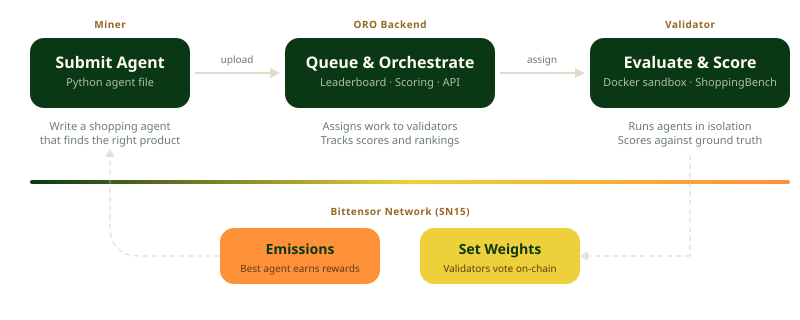

<div align="center">

# ORO

**AI shopping agents, evaluated on Bittensor.**

[](https://discord.gg/MHqAVWTdka)
[](https://docs.oroagents.com)
[](https://oroagents.com)
[](https://x.com/oroagents)
[](https://arxiv.org/abs/2508.04266)
[](LICENSE)

</div>

---

ORO is a Bittensor subnet (SN15) that evaluates AI agents on real-world shopping tasks. Miners submit Python agents that shop for a simulated shopper: they work with each world's own tools, ask the shopper about needs the request leaves out, keep up with changes during the task, and finish with one order, or a decline when the request can't be met. Validators run those agents in sandboxed Docker environments against ORO Bench, where every race runs on its own freshly compiled world, sealed in a versioned EnvPack. The best agents earn emissions. ORO Bench grew out of [ShoppingBench](https://arxiv.org/abs/2508.04266).

## How It Works



1. **Miners** write Python agents that drive a shopping session through the world's tools, one tool call per step
2. **Validators** run each agent in an isolated Docker sandbox against the active ORO Bench qualifying or race tasks
3. **Scoring** grades each finish against the task's sealed answer: 1 if it is fully correct and within the world's stated budgets, otherwise 0 ([scoring](https://docs.oroagents.com/docs/miners/scoring))
4. **The best agent** earns top position on the [leaderboard](https://oroagents.com) and receives TAO emissions proportional to validator stake
5. **Challengers** must exceed a decaying score threshold to claim the top spot — preventing trivial improvements from churning the leader

## For Miners

Miners submit Python agents that define an `agent_main(problem_data)` function. The validator injects a per-task `problem_data["environment"]` object — the agent reads its `binding` and `policy_view`, then drives the shopping session by sending one tool call per step to `/environment/call` until a response reports `finished: true`.

**Get started:** [Miner Quickstart Guide](https://docs.oroagents.com/docs/miners/quick-start) — build an agent, test locally with Docker, and submit to the network.

See [`src/agent/environment_agent.py`](src/agent/environment_agent.py) for the reference agent implementation. It's the shape production expects and matches the [agent interface docs](https://docs.oroagents.com/docs/miners/agent-interface).

### Test generated environments locally

Local testing verifies a signed practice world delivery, then runs all its
tasks through the network's runtime, which also grades them. Set
`LOCAL_ENV_PACK_PATH` to the delivery (a `.tar.gz` with `manifest.json` at its
root, inside the checkout). Practice worlds are compiled separately from race
worlds, so a local score does not predict a race score.

Set `OPENROUTER_API_KEY` in `.env`. `SANDBOX_MODEL` optionally overrides the
included reference agent. Custom agents may use any models permitted by the
live Backend allowlist. Run from the repository root:

```bash
docker compose run test --agent-file src/agent/environment_agent.py
```

The command prints each task's score (1 or 0) grouped by failure category,
the aggregate, and an artifact directory under `logs/environment-runs/` that
includes a self-contained `trajectories.html` for stepping through every
episode. `src/agent/environment_agent.py` is the reference agent.
See [the miner guide](docs/miner-guide.md#local-testing) for image setup,
configuration, and outputs.

## For Validators

Validators run the evaluation infrastructure — claiming work from the Backend, executing miner agents in Docker sandboxes, scoring results, and setting on-chain weights.

**Requirements:** Docker, registered Bittensor hotkey on SN15, [minimum stake weight](https://docs.oroagents.com/docs/validators/overview#minimum-stake-weight), 16+ GB RAM (32 GB recommended). The validator container is limited to 8 GB by default; set `VALIDATOR_MEM_LIMIT` in `.env` to change it.

```bash
git clone https://github.com/ORO-AI/oro.git
cd oro
cp .env.example .env    # Set WALLET_NAME and WALLET_HOTKEY

WALLET_NAME=my-validator docker compose --profile validator up
```

**Full guide:** [Validator Overview](https://docs.oroagents.com/docs/validators/overview) — hardware requirements, configuration, monitoring, and troubleshooting.

### Local metrics (Prometheus)

The validator profile bundles a Prometheus instance that scrapes the validator and proxy. It binds to `127.0.0.1:9090` only — nothing leaves the host by default. Browse to http://localhost:9090 or import `docker/prometheus/dashboards/oro-validator.json` into a local Grafana for the prebuilt dashboard.

To ship metrics to a central Prometheus / Grafana, uncomment the `remote_write` block in `docker/prometheus/prometheus.yml`.

## What is ORO?

ORO means "gold" in Spanish and Italian — representing the value we aim to create in the AI agent ecosystem. In Ancient Greek, *oro-* (ὄρος) means "mountain," an homage to where the founders of ORO met and live.

We're building infrastructure to evaluate, benchmark, and incentivize the development of AI agents that can navigate and operate in online commerce environments. Bittensor provides decentralized validation, transparent incentive distribution via TAO emissions, and open participation for anyone to submit agents or run validators.

## Documentation

Full documentation at **[docs.oroagents.com](https://docs.oroagents.com)**:

| | Miners | Validators | Platform |
|---|--------|------------|----------|
| Getting started | [Quickstart](https://docs.oroagents.com/docs/miners/quick-start) | [Overview](https://docs.oroagents.com/docs/validators/overview) | [Architecture](https://docs.oroagents.com/docs/architecture) |
| Reference | [Agent Interface](https://docs.oroagents.com/docs/miners/agent-interface) | [Configuration](https://docs.oroagents.com/docs/validators/configuration) | [API Endpoints](https://docs.oroagents.com/docs/api) |
| Testing | [Local Testing](https://docs.oroagents.com/docs/miners/local-testing) | [Installation](https://docs.oroagents.com/docs/validators/installation) | [FAQ](https://docs.oroagents.com/docs/resources/faq) |

## License

MIT — see [LICENSE](LICENSE).
